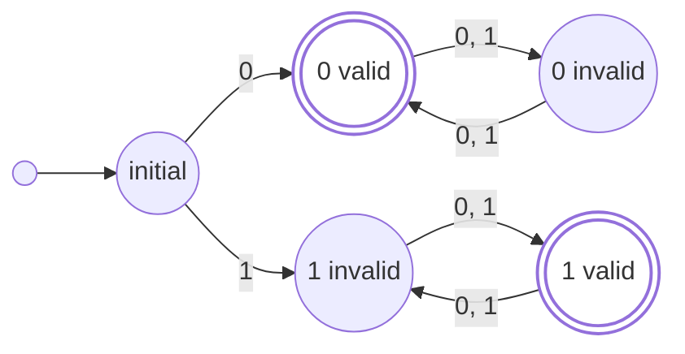

# CS 197 HZZQ - Assessment 11

Submitted by Stephen Sabas Singer on October 23, 2026

## Computing Problem and Language

### Computing Problem

> [!Question] First Item
> Define one computing problem. State its input and output.

#### Scenario

Imagine a console-based Role-Playing Game (RPG) where a player controls a mage whose actions are submitted sequentially into an input stream. The system operates over a finite alphabet of actions $\Sigma = \{f, e, w, c, l\}$, where $f$, $e$, and $w$ denote elemental enchants (fire, earth, and water), $c$ represents a channel action, and $l$ signifies a link action. The computational goal is to determine whether an arbitrary input stream $x \in \Sigma^*$ contains a prefix that completes a valid spell $s$.

#### Valid Repeating Patterns

Initially, any input prior to the channel action $c$ is ignored and treated as inconsequential noise (for example, the prefix $fefefefwww$ in $fefefefwwwce$). The execution of $c$ serves as the trigger that initiates active spell tracking, though a standalone $c$ does not satisfy the requirements of a complete spell. From this trigger, the sequence must immediately proceed into a non-empty run of repeating identical elemental enchants, such as $cf$, $ce$, $cw$, $cfff$, $cee$, or $cwww$. Abruptly switching elements without a proper bridge (as in $cffe$, $cwef$, or $cwwwwwf$) renders the sequence invalid.

#### Valid Link Patterns

To transition between enchants or switch elements, the mage must utilize the link action $l$, which functions strictly as an infix transition sandwiched between elemental enchants. Valid uses of the link operator allow flexible chaining, such as $cffffle$, $cwlewlewle$, or $cwlf$. Conversely, structural violations such as ending a sequence on a link ($ceel$, $cfffl$), using consecutive links ($cffflle$), or placing a link immediately after the channel action ($cl$) are prohibited. Whenever an invalid state is reached, all subsequent inputs are ignored until a new channel action $c$ appears to restart the validation process.

### Language

#### Definition

> [!Question] Second Item
> Explain the language this computing problem corresponds to.

The language $L$ corresponding to the Rune Stream Validation problem can be formally recognized by a Deterministic Finite Automaton (DFA), defined as the following

$$M = (Q, \Sigma, \delta, q_0, F)$$

#### Alphabet

As already defined in the computing problem, there are five acceptable inputs.

$$\Sigma = \{f, e, w, c, l\}$$

#### Expected States

There are six expected states for this DFA:

$Q = \{q_0, q_c, q_f, q_e, q_w, q_{l}\}$

- $q_0$: Initial / Reset State
- $q_c$: Channel Triggered
- $q_f, q_e, q_w$: Currently in an active elemental run
- $q_l$: Post-link state, waiting on the next element

In this case, the start state is $q_{0} \in Q$. The set of accepting states are $F = \{q_f, q_e, q_w\}$.

#### Transition Function

The complete state transitions for every state and input symbol are defined as follows:

##### Initial / Reset State ($q_0$)

$$\begin{aligned} \delta(q_0, c) &= q_c \\ \delta(q_0, x) &= q_0 \quad \forall x \in \{f, e, w, l\} \end{aligned}$$

##### Triggered State ($q_c$)

$$\begin{aligned} \delta(q_c, f) &= q_f \\ \delta(q_c, e) &= q_e \\ \delta(q_c, w) &= q_w \\ \delta(q_c, c) &= q_c \\ \delta(q_c, l) &= q_0 \quad (\text{Invalid: resets to } q_0) \end{aligned}$$

##### Active Fire Run ($q_f$)

$$\begin{aligned} \delta(q_f, f) &= q_f \\ \delta(q_f, l) &= q_l \\ \delta(q_f, c) &= q_c \\ \delta(q_f, x) &= q_0 \quad \forall x \in \{e, w\} \quad (\text{Invalid: resets to } q_0) \end{aligned}$$

##### Active Earth Run ($q_e$)

$$\begin{aligned} \delta(q_e, e) &= q_e \\ \delta(q_e, l) &= q_l \\ \delta(q_e, c) &= q_c \\ \delta(q_e, x) &= q_0 \quad \forall x \in \{f, w\} \quad (\text{Invalid: resets to } q_0) \end{aligned}$$

##### Active Water Run ($q_w$)

$$\begin{aligned} \delta(q_w, w) &= q_w \\ \delta(q_w, l) &= q_l \\ \delta(q_w, c) &= q_c \\ \delta(q_w, x) &= q_0 \quad \forall x \in \{f, e\} \quad (\text{Invalid: resets to } q_0) \end{aligned}$$

##### Post-Link State ($q_l$)

$$\begin{aligned} \delta(q_l, f) &= q_f \\ \delta(q_l, e) &= q_e \\ \delta(q_l, w) &= q_w \\ \delta(q_l, c) &= q_c \\ \delta(q_l, l) &= q_0 \quad (\text{Invalid: consecutive links, resets to } q_0) \end{aligned}$$

## Deterministic Finite Automata Example

> [!Question] Third Item
> Consider the following state diagram of DFA $M_1​$
> 1. What is the start state?
> 2. What is the set of accept states?
> 3. What sequence of states does the machine go through on input $aabb$ ?
> 4. Does the machine accept the string $aabb$ ?
> 5. Does the machine accept the string $\epsilon$ ?

![[Pasted image 20261023185240.png]]

### Initial State

This Deterministic Finite Automata (DFA) $M = (Q, \Sigma, \delta, q_0, F)$ starts at $q_{1}$ **(answer to 1)**. Since $q_{1} \in F$ (based on the graph) and it is the initial state, it stands that just entering the system results in an accepted state so $\epsilon \in L(M)$ **(answer to 5)**.

### Accept States

The accept states for $M$ are $F=\{ q_{1}, q_{4} \}$ **(answer to 2)**.

The two accepting states occur on repeating stream of either $a$ or $b$.

In the case a repeating $a$ is broken by a $b$ in the stream then it must insert a $ab$ into the stream to return back to $q_{1}$. If instead a repeating $a\dots$ is introduced after the breaking $b$, it will stay invalid. An alternative would be to instead insert a $b$ into the stream to start the case of repeating $b$.

Conversely, in the case a repeating $b$ is broken by an $a$ in the stream, then it must also insert an $ab$ into the stream to return back to $q_{4}$. If instead a repeating $a\dots$ is introduced, it will also stay invalid. Another alternative is to insert a $b$ too after the breaking $a$ to start the case of repeating $a$.

In summary, the state remains valid for as long as its in a repeating valid state. On break, either insert $ab$ to revert back to the original repeating valid state or insert $b$ to transition to the alternative repeating valid state.

### Example Input

As a specific example, consider the input $x=aabb$ **(answer to 3)**.
- Start at $q_{1}$ for $x_{0} = \epsilon$.
- At $x_{1} = x_{2} = a$, there will be a transition $\delta(q_{1}, a)=q_{1}$
- At $x_{3} = b$, there will be a transition $\delta(q_{1}, b) = q_{2}$
- Finally, at $x_{4} = b$, there will be a transition $\delta(q_{2}, b) = q_{4}$

If the explanation earlier was followed, the repeating valid state $aa$ was broken by the third input $b$ but was corrected by the additional $b$.

Since $q_{4} \in F$, $x=aabb \in L(M)$ **(answer to 4)**.

## Computing Problem to Deterministic Finite Automata

> [!Question] Fourth Item
> Create a DFA that recognizes the following language. The alphabet is \{0,1\}.
>
> $L = \{ w | w \text{ starts with }0 \text{ and has odd length, or starts } 1 \text{ and has even length}\}$​

$L$ corresponding to the DFA can be formally recognized by a Deterministic Finite Automaton (DFA) $M$, defined as the following:

$$M = (Q, \Sigma, \delta, q_0, F)$$

### Alphabet

The input symbols that the DFA reads are:

$$\Sigma = \{0, 1\}$$

### Expected States

There are five expected states for this DFA:

$$Q = \{\text{initial}, \text{zero\_valid}, \text{zero\_invalid}, \text{one\_invalid}, \text{one\_valid}\}$$

- $\text{initial}$: Start State
- $\text{zero\_valid}$: Started with 0, currently holding an odd length
- $\text{zero\_invalid}$: Started with 0, currently holding an even length
- $\text{one\_invalid}$: Started with 1, currently holding an odd length
- $\text{one\_valid}$: Started with 1, currently holding an even length

In this case, the start state is $q_0 = \text{initial} \in Q$. The set of accepting states are $F = \{\text{zero\_valid}, \text{one\_valid}\}$.

### Transition Function

The complete state transitions for every state and input symbol are defined as follows:

Initial State ($\text{initial}$)

$$
\begin{aligned} 
\delta(\text{initial}, 0) &= \text{zero\_valid} \\
\delta(\text{initial}, 1) &= \text{one\_invalid} 
\end{aligned}
$$

Zero Valid State ($\text{zero\_valid}$)

$$
\begin{aligned} 
\delta(\text{zero\_valid}, 0) &= \text{zero\_invalid} \\ \delta(\text{zero\_valid}, 1) &= \text{zero\_invalid} 
\end{aligned}$$

Zero Invalid State ($\text{zero\_invalid}$) 

$$

\begin{aligned}
\delta(\text{zero\_invalid}, 0) &= \text{zero\_valid} \\ \delta(\text{zero\_invalid}, 1) &= \text{zero\_valid}
\end{aligned}

$$

One Invalid State ($\text{one\_invalid}$) 

$$

\begin{aligned}
\delta(\text{one\_invalid}, 0) &= \text{one\_valid} \\
\delta(\text{one\_invalid}, 1) &= \text{one\_valid}
\end{aligned}

$$

One Valid State ($\text{one\_valid}$) 

$$

\begin{aligned}
\delta(\text{one\_valid}, 0) &= \text{one\_invalid} \\ \delta(\text{one\_valid}, 1) &= \text{one\_invalid}
\end{aligned}

$$
